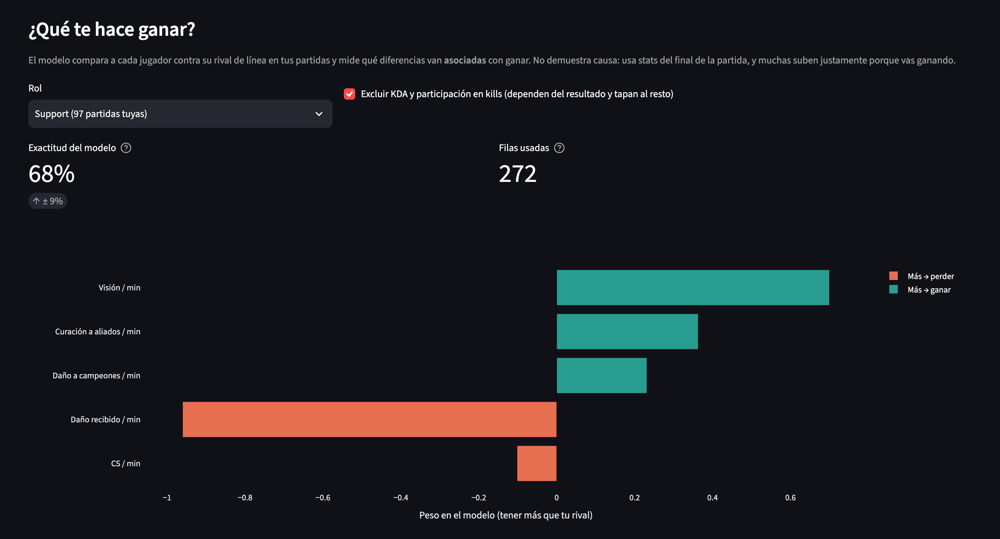
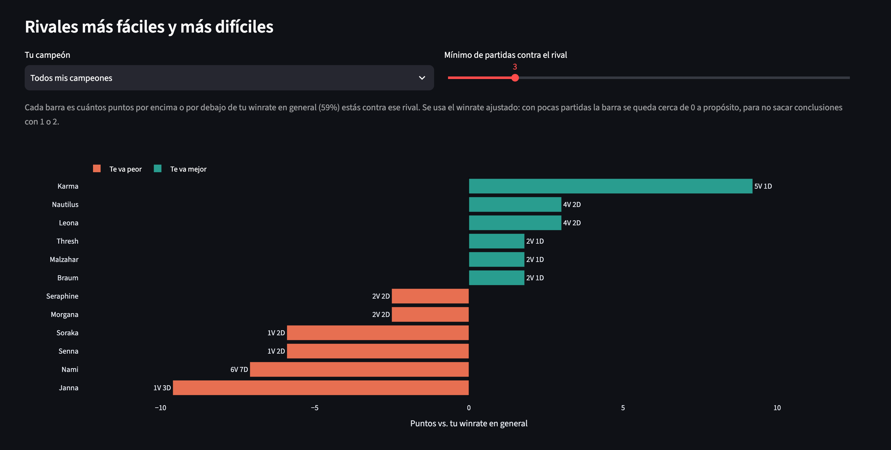

# LoL Coach

Analiza las partidas de cualquier jugador de League of Legends y muestra qué lo hace ganar:
rendimiento por campeón, matchups, tendencia y un modelo por rol que compara al jugador
contra su rival de línea.

**Cómo funciona**

1. Escribes un Riot ID (`Nombre#TAG`), la región y la cola (SoloQ o Flex).
2. La app descarga las últimas partidas desde la API de Riot, respetando los límites de
   llamadas, con descargas en paralelo.
3. Las partidas se guardan en una base SQLite **en memoria**. No se escribe nada en disco
   y todo se libera al buscar a otro jugador o al cerrar la pestaña.
4. Se calculan las estadísticas y se entrena una regresión logística por rol.





## Análisis

- **Winrate ajustado (bayesiano):** con pocas partidas, el winrate de un campeón se acerca
  al winrate general del jugador, para no sacar conclusiones con 1 o 2 partidas.
- **¿Qué te hace ganar?:** regresión logística por rol sobre las diferencias contra el
  rival de línea (daño, visión, CS, daño recibido por minuto). Se valida con `GroupKFold`
  por partida, para que las dos filas de una misma partida nunca queden separadas entre
  entrenamiento y prueba. Mide **asociación, no causa**: usa estadísticas del final de la
  partida.
- **Coach:** un LLM (Gemini) que responde preguntas usando las estadísticas reales del jugador.

## Hallazgos

Datos: 136 partidas de SoloQ completas en LAN (1,360 filas de jugadores, 272 por rol), todas de
un mismo jugador que hoy está en Master. Es su historial completo de SoloQ disponible en la API
(142 partidas; las 6 restantes eran remakes). Modelo: regresión logística por rol sobre **tu
valor − el de tu rival de línea**, con validación cruzada de 5 grupos por partida.

**1. Lo que separa al ganador de su rival cambia según el rol.** Sin KDA ni participación en kills:

| Rol | Exactitud | Diferencia más asociada con ganar |
|---|---|---|
| ADC | 74% ± 8% | Recibir menos daño (−1.00), más CS/min (+0.65) y más daño (+0.51) |
| Jungla | 71% ± 2% | Más CS/min que el jungla rival (+0.94) y más daño (+0.47) |
| Support | 68% ± 9% | Recibir menos daño (−0.96) y más visión por minuto (+0.70) |
| Mid | 60% ± 13% | Más daño a campeones (+0.74), más visión (+0.38) y recibir menos daño (−0.38) |
| Top | 59% ± 14% | Más daño por minuto (+0.90); el modelo menos confiable |

Los coeficientes están estandarizados: +1.0 significa que tener una desviación estándar más que
tu rival multiplica por ~2.7 las probabilidades de ganar, con el resto de las métricas fijas.

**2. El KDA predice casi todo, y por eso se excluye.** Con KDA, la exactitud sube a 85–89% en
todos los roles, pero el KDA es más resultado que causa: quien va ganando mata más y muere
menos. Se excluye por defecto, igual que el oro, para ver qué más pesa.

**3. Comparar contra el rival funciona mejor que comparar dentro del equipo.** Las métricas de
"porcentaje del equipo" (porcentaje del daño, de la visión, del daño recibido) tienen
correlación 0.00 con ganar: siempre suman 100% dentro del equipo, ganes o pierdas. Con ellas,
el modelo queda en 51–70%. Con las diferencias contra el rival, sube a 59–74%.

**4. La participación en kills sale negativa por un efecto de supresión, no por
multicolinealidad** (VIF < 2.5 en todas las métricas). Con el KDA fijo, una participación más
alta significa que el equipo hizo menos kills en total.

**5. El winrate ajustado evita conclusiones con pocas partidas.** Karma: 6 de 15 (40% real),
ajustado a 48%. Renata: 13 de 19 (68% real), ajustado a 65%. Con pocas partidas, el ajuste
acerca cada valor al winrate general del jugador (59%).

**Limitaciones**
- **Asociación, no causa:** son estadísticas del final de la partida, y muchas suben porque ya
  vas ganando.
- **Muestra chica y de un solo jugador:** 272 filas por rol, todas de partidas donde juega la
  misma persona en un mismo elo. La variación entre grupos (±14% en Top, ±13% en Mid) indica
  que esos resultados todavía no son estables.
- **Siguiente paso:** ampliar a miles de partidas de jugadores del mismo elo y agregar
  variables del inicio de la partida (diferencia de oro y CS a los 10 y 15 minutos, con el
  endpoint de timeline), que sirven para decidir durante la partida y no solo para explicarla.

## Ejecutar en local

```bash
python -m venv venv && source venv/bin/activate
pip install -r requirements.txt
cp .env.example .env                 # y completa las claves
streamlit run app/dashboard.py
python -m pytest tests               # tests
python app/analysis.py --sin-kda     # análisis por terminal (modo dueño, con data/lol.db)
```

## Estructura

| Archivo | Qué hace |
|---|---|
| `app/riot_client.py` | Cliente de la API de Riot: regiones, reintentos, límite de llamadas, descargas en paralelo |
| `app/live.py` | Consulta temporal: descarga a una base en memoria y la libera |
| `app/models.py` | Tablas (SQLAlchemy) y bases en disco o en memoria |
| `app/stats.py` | Matchups y winrate ajustado por campeón y por matchup |
| `app/analysis.py` | Features y regresión logística por rol |
| `app/coach.py` | Prompt y llamada a Gemini |
| `app/dashboard.py` | Interfaz en Streamlit |

---

LoL Coach isn't endorsed by Riot Games and doesn't reflect the views or opinions of Riot Games
or anyone officially involved in producing or managing Riot Games properties. Riot Games, and
all associated properties are trademarks or registered trademarks of Riot Games, Inc.
